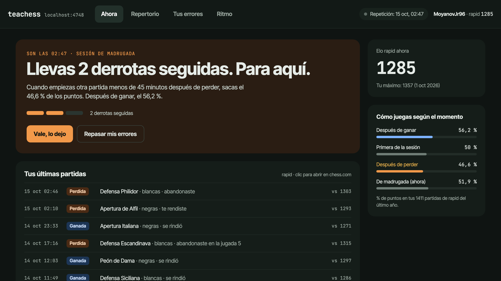

# teachess

**Your chess.com games, from the terminal and in a live dashboard on localhost.**

`teachess` downloads your games from chess.com, runs Stockfish over every opening you have played in the
last year, and turns the result into a coach: it tells you where your games go wrong, which lines cost you
points, drills the mistakes you keep repeating, and tells you to stop when you are on a losing streak.



It started as a one-off analysis of my own 5,600 games. Three things came out of it, and the tool is built
around them:

- **The first serious mistake comes early.** In 82 % of my games one move before move 12 lost 0.8 pawns or
  more, and the median was move 6, right where my opening memory ends.
- **The repertoire was not too narrow. It forked too early.** I played 1.e4 every game, then split across
  four different third moves. Two of them scored 56–57 %, the other two 40–43 %.
- **I played worse after a loss.** Starting a game within 45 minutes of a defeat scored 45.6 %; after a win, 56.1 %.

## What you get

| Command | What it does |
|---|---|
| `teachess dash` | Opens the dashboard on `http://localhost:4747` and watches chess.com every 2 minutes |
| `teachess today` | Where you stand right now: current session, losing streak, whether you should stop |
| `teachess games` | Your games (`--since 30d`, `--tc rapid\|blitz\|bullet\|daily\|all`) |
| `teachess openings` | Your openings with the share of points and how often you go wrong before move 12 |
| `teachess review [url\|last]` | Stockfish over one game: every costly move and what you should have played |
| `teachess progress` | Month by month: rating, points, and how early your first serious mistake comes |
| `teachess drill` | Spaced-repetition flashcards of your repeated mistakes, in the terminal |
| `teachess sync` | Fetches new games, evaluates them and rebuilds the report |
| `teachess watch install` | A background service that notifies you when a game ends (its first mistake) and when to stop |
| `teachess coach` | Creates your coach folder and opens Claude Code in it (see below) |
| `teachess skill install` | Teaches every Claude Code session how to use teachess |
| `teachess mcp install claude-code\|claude-desktop` | Registers teachess as an MCP server, so Claude can call it as tools |

Every command takes `--json`, so a script or an AI agent can read your state:

```console
$ teachess today --json
{
  "state": "streak",
  "losses_in_a_row": 2,
  "score_after_loss": 46.6,
  "advice": "Para 45 minutos: después de perder sacas el 46,6 % de los puntos.",
  ...
}
```

Exit codes are stable: `0` ok, `2` bad arguments, `3` setup missing (no username, no data yet), `4` game or card not
found, `5` chess.com unreachable or rate-limiting. With `--json`, stderr carries `{"error": {"code", "exit", "message"}}`.

## After every game

`teachess watch install` adds a macOS background service (a LaunchAgent running `teachess watch --once` every two
minutes) that checks chess.com even with the dashboard closed. When a rapid game ends you get a notification
with its lesson: "Error on move 4.Bc4, the same one as in 11 games; the right move was 4.d4. It is in your cards."
After two defeats in a row it tells you to stop for 45 minutes and review your cards instead. To get the same
notifications on your phone, install [ntfy](https://ntfy.sh), subscribe to a topic only you know and add
`"notify": {"ntfy": "https://ntfy.sh/<topic>"}` to `config.json`; a tap opens the game. `teachess watch status`
shows the service and its log; `teachess watch uninstall` removes it. `teachess watch` runs the same loop in the
foreground.

## Talk to Claude about your games

teachess gives an agent three ways in, from the lightest to the most complete:

- **The skill.** `teachess skill install` writes `~/.claude/skills/teachess/SKILL.md`, the command reference for
  agents. Any Claude Code session can then answer "how am I doing in chess?" by calling the CLI itself.
  `teachess skill` prints the same guide for any other agent.
- **The coach folder.** `teachess coach` creates `~/teachess-coach/` and opens Claude Code there. The folder holds
  a `CLAUDE.md` that makes Claude your coach and `notas.md`, a training journal seeded with your starting numbers.
  The coach reads the journal at the start of each conversation, checks your games, and appends a dated entry
  when you agree on what to work on, so next week it can tell you whether your first mistake moved from move 6
  to move 8. It can also quiz you on your own repeated mistakes, one card at a time. `teachess coach "should I
  keep playing tonight?"` opens it with a question.
- **The MCP server.** `teachess mcp install claude-code` (or `claude-desktop`) registers `teachess mcp`, a
  [Model Context Protocol](https://modelcontextprotocol.io) server on stdio with read tools (`today`, `progress`,
  `games`, `openings`, `review`, `drill`) plus `sync` and `drill_answer`. Each tool runs the CLI command of the
  same name and returns the same JSON. This is the way in for apps without a shell, like Claude Desktop.

The coach folder and the MCP server work together: the folder's settings allow both the CLI and the MCP tools.

### The dashboard

Four tabs, all built from your own games:

- **Ahora (Now):** the state of your session, the losing-streak meter, your latest games. When you finish a game
  on chess.com it shows up within two minutes with Stockfish's verdict: "error on move 7, the same one as in
  11 earlier games".
- **Repertorio (Repertoire):** your opening tree, move by move, coloured by the points you score in each line.
- **Tus errores (Your mistakes):** a board with the positions where you keep making the same mistake. Pick a move; the card comes
  back tomorrow if you miss it and later each time you get it right (Leitner boxes, shared with `teachess drill`).
- **Ritmo (Rhythm):** rating curve, the move of your first serious mistake, a heat map of when you play and when you
  win, the clock you have left when you lose.

| Repertoire | Your mistakes |
|---|---|
|  |  |


`teachess dash --at 2026-10-15T02:47` replays a past moment offline, which is how these screenshots were taken.

## Install

You need Python 3.9 or newer and [Stockfish](https://stockfishchess.org/) on your `PATH`
(`brew install stockfish` on macOS, `apt install stockfish` on Debian/Ubuntu).

```bash
git clone https://github.com/hector14mv/teachess.git
cd teachess
python3 -m venv .venv
.venv/bin/pip install -r requirements.txt
cp config.example.json config.json            # put your chess.com username in it
ln -s "$PWD/bin/teachess" ~/.local/bin/teachess   # any directory on your PATH works
teachess sync
teachess dash
```

The first `sync` downloads your whole archive and evaluates a year of rapid openings in parallel. Depending
on how much you play, that can take several minutes. After that, each sync only fetches the current month
and evaluates the new games.

Instead of `config.json` you can set `TEACHESS_USER=<username>`. `config.json` can also hold your own
coaching notes for the Repertoire tab, keyed by colour and line (see `config.example.json`). A note's `move` is
your plan for that position, and the drills follow it: a mistake you make with the planned move is not drilled,
and where Stockfish prefers another move, the card asks for the plan's move instead.

## How it works

```
chess.com public API ─▶ fetch_games.py ─▶ data/raw/YYYY-MM.json
                        parse_games.py ─▶ data/games.jsonl      (one row per game, your side)
                        engine_eval.py ─▶ data/evals.json       (Stockfish, depth 12, first 24 plies)
                        build_report.py ─▶ data/report.json     (tree, drills, habits)
                                             │
                     teachess (CLI) ◀────────┴────────▶ teachess dash (127.0.0.1 + watcher)
                            │
             teachess mcp (stdio) · skill · coach folder ─▶ Claude Code / Claude Desktop
```

- It reads only chess.com's [public data API](https://www.chess.com/news/view/published-data-api). There is
  no login and nothing is written to chess.com. Requests are serial because chess.com rate-limits parallel calls.
- Everything stays on your machine, in `data/`. The dashboard listens on `127.0.0.1` only.
- The analysis covers rapid games from the last 365 days. A "mistake" is a move that loses 80 centipawns or
  more. A drill is a position where you played the same bad move at least three times.
- No dependencies beyond [python-chess](https://python-chess.readthedocs.io/): the server is the standard
  library's `http.server`, the dashboard is one HTML file, and the MCP server is plain JSON-RPC over stdio.

## Tests

`.venv/bin/python tests/test_watch.py` runs the watcher's scenarios (daylight saving time, several games between
checks, one stop per streak, failed notifications, a corrupt state file, two watchers at once) on synthetic games.

## Limits

- The interface and the coaching text are in Spanish for now.
- chess.com's monthly archive can lag behind a finished game by a few minutes.
- Stockfish only looks at the opening (the first 24 plies), not the whole game.

## License

[MIT](LICENSE)
