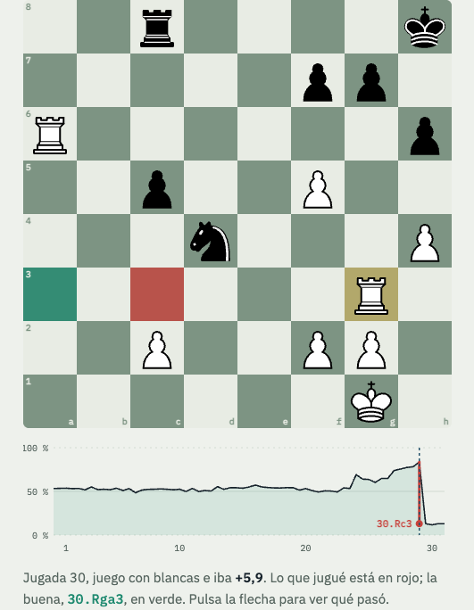
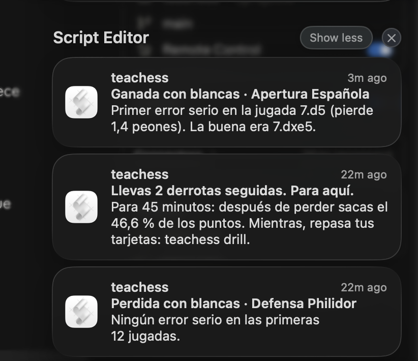
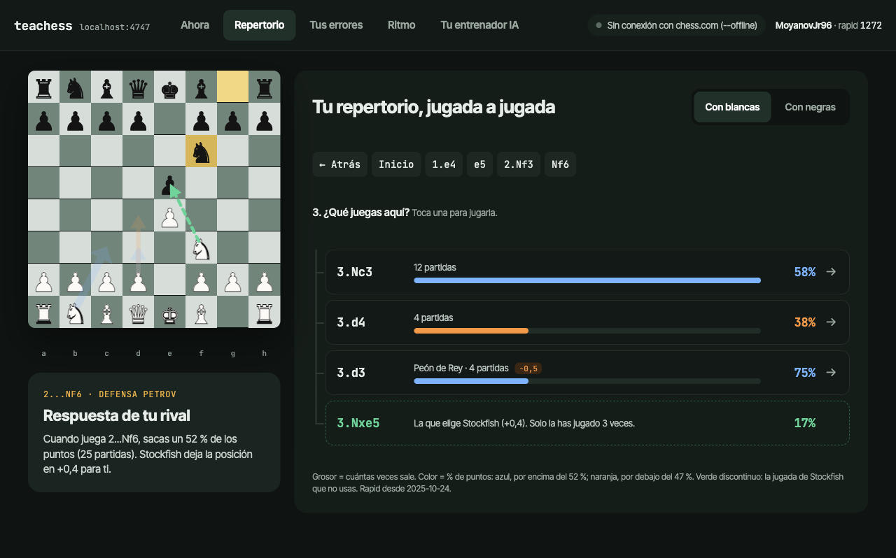
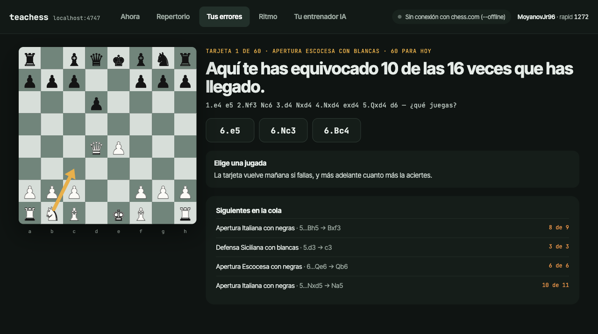
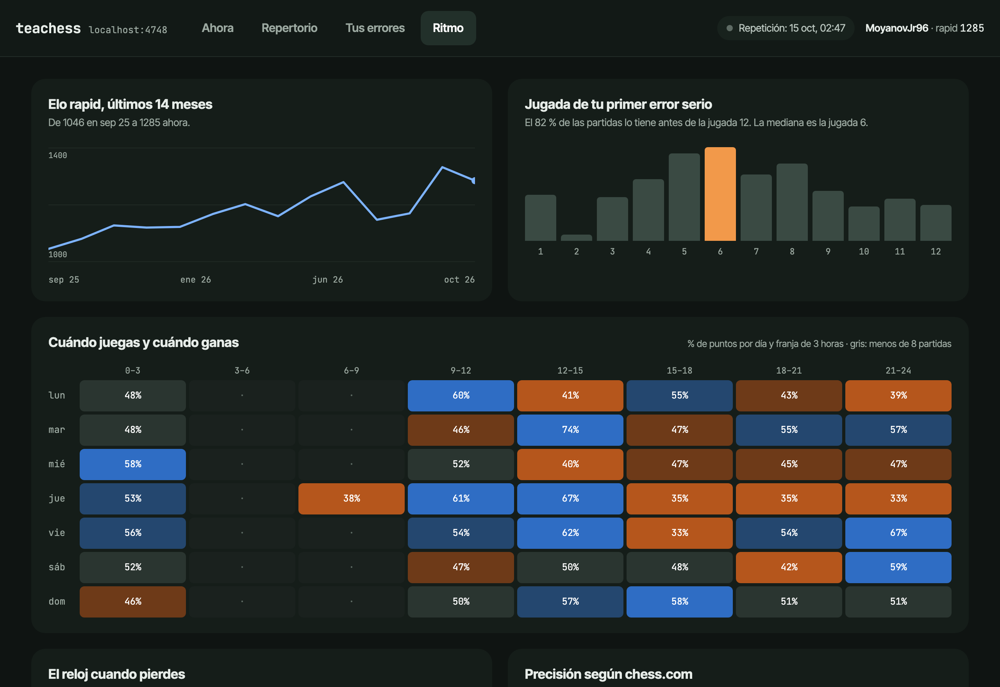

# teachess

**A chess coach for your chess.com games that lives in your terminal and talks to Claude.**

teachess downloads your games, runs Stockfish over every move, and after each game tells you where it went
wrong. It turns your own blunders into puzzles, drills the opening mistakes you keep repeating, and tells you to
stop when you are on a losing streak. Every command speaks JSON, so Claude Code (or any agent) can be your coach.
Made in the spirit of [wallapop-cli](https://github.com/Microck/wallapop-cli): a CLI built for agents.

<p align="center">
  
</p>

## Install

```bash
brew install hector14mv/tap/teachess
```
```bash
teachess
```

Homebrew brings Python and [Stockfish](https://stockfishchess.org/) with it. The first `teachess` asks for your
chess.com username and how much of your history to analyse. The options appear within seconds and are built from
your own games: the time control you play most, how many games each window holds, and how long Stockfish takes on
your machine (measured on a sample). It recommends the shortest window with about 300 games, because recent games
say how you play now; with a small archive it analyses everything without asking. Only the window you pick is
downloaded; `~` marks a count estimated from the size of months not downloaded yet. A first install takes about
five minutes for 500 games, and it ends by opening the dashboard in your browser.

```
¿Cuánto historial quieres que analice? Stockfish mira cada jugada.

  1. Últimos 3 meses           489 partidas         ~4 min  ← recomendado
  2. Último año             ~1.391 partidas        ~10 min
  3. Últimos 3 años         ~2.283 partidas        ~17 min
  4. Todo (desde 2021)       5.287 partidas        ~38 min
```

Agents pass everything as flags: `teachess setup --user NAME --window 1y --json`, or `teachess setup --json`
for the options.

Without Homebrew (Linux, or to work on the code) you need Python 3.9 or newer and Stockfish
(`apt install stockfish`):

```bash
git clone https://github.com/hector14mv/teachess.git && cd teachess
```
```bash
python3 -m venv .venv && .venv/bin/pip install -e .
```
```bash
.venv/bin/teachess setup
```

Then put it on your `PATH` so Claude can call it: `ln -s "$PWD/.venv/bin/teachess" ~/.local/bin/teachess`.

> The interface and the coaching text are in Spanish. The background notifier is a macOS service; on Linux, run
> `teachess watch --once` from cron or a systemd timer every two minutes.

## After every game

<p align="center">
  
</p>

`teachess watch install` adds a background service that checks chess.com every two minutes, with nothing open.
When a game ends you get a notification with its lesson: the move that decided it and the right one, and whether
it is a mistake you keep repeating. After two defeats in a row it tells you to stop for 45 minutes and review your
cards instead. To get them on your phone too, install [ntfy](https://ntfy.sh), subscribe to a topic only you know
and add `"notify": {"ntfy": "https://ntfy.sh/<topic>"}` to `config.json`; a tap opens the game.
`teachess watch status` shows the service and its log; `teachess watch uninstall` removes it.

## What it found in my games

It started as an analysis of my own 5,600 games. A few things came out of it, and the tool is built around them:

- **Most of my losses are decided by one blunder, and late.** 96 % of my losses have one, and in 69 % the worst
  comes after move 12 (median: move 18). I thought I lost in the opening.
- **The first serious mistake still comes early.** In 82 % of my games one move before move 12 loses 0.8 pawns
  or more, right where my opening memory ends.
- **I play worse after a loss.** Starting a game within 45 minutes of a defeat I score 46.6 % of the points;
  after a win, 56.2 %.

## What you get

| Command | What it does |
|---|---|
| `teachess today` | Where you stand right now: current session, losing streak, whether you should stop |
| `teachess games` | Your games (`--since 30d`, `--tc rapid\|blitz\|bullet\|daily\|all`) |
| `teachess openings` | Your openings with the share of points and how often you go wrong before move 12 |
| `teachess review [url\|last]` | Stockfish over one game: every costly move and what you should have played |
| `teachess progress` | Month by month: rating, points, and how early your first serious mistake comes |
| `teachess drill` | Spaced-repetition cards: your repeated opening mistakes and puzzles from your own blunders |
| `teachess setup` | Asks your username and how much of your history to analyse, with options built from your own archive |
| `teachess sync` | Fetches new games, evaluates them and rebuilds the report |
| `teachess watch install` | A background service that notifies you when a game ends (its lesson) and when to stop |
| `teachess dash` | A local dashboard on `http://localhost:4747` (see below) |
| `teachess coach` | Creates your coach folder and opens Claude Code in it (see below) |
| `teachess skill install` | Teaches every Claude Code session how to use teachess |
| `teachess mcp install claude-code\|claude-desktop` | Registers teachess as an MCP server, so Claude can call it as tools |

Every command takes `--json`, so a script or an AI agent can read your state:

```console
$ teachess today --json
{
  "state": "streak",
  "losses_in_a_row": 2,
  "score_after_loss": 46.6,
  "advice": "Para 45 minutos: después de perder sacas el 46,6 % de los puntos.",
  ...
}
```

Exit codes are stable: `0` ok, `2` bad arguments, `3` setup missing (no username, no data yet), `4` game or card not
found, `5` chess.com unreachable or rate-limiting. With `--json`, stderr carries `{"error": {"code", "exit", "message"}}`.

## Talk to Claude about your games

teachess gives an agent three ways in, from the lightest to the most complete:

- **The skill.** `teachess skill install` writes `~/.claude/skills/teachess/SKILL.md`, the command reference for
  agents. Any Claude Code session can then answer "how am I doing in chess?" by calling the CLI itself.
  `teachess skill` prints the same guide for any other agent.
- **The coach folder.** `teachess coach` creates `~/teachess-coach/` and opens Claude Code there. The folder holds
  a `CLAUDE.md` that makes Claude your coach and `notas.md`, a training journal seeded with your starting numbers.
  The coach reads the journal at the start of each conversation, checks your games, and appends a dated entry
  when you agree on what to work on, so next week it can tell you whether your first mistake moved from move 6
  to move 8. It can also quiz you on your own repeated mistakes, one card at a time. `teachess coach "should I
  keep playing tonight?"` opens it with a question.
- **The MCP server.** `teachess mcp install claude-code` (or `claude-desktop`) registers `teachess mcp`, a
  [Model Context Protocol](https://modelcontextprotocol.io) server on stdio with read tools (`today`, `progress`,
  `games`, `openings`, `review`, `drill`) plus `sync` and `drill_answer`. Each tool runs the CLI command of the
  same name and returns the same JSON. This is the way in for apps without a shell, like Claude Desktop.

The coach folder and the MCP server work together: the folder's settings allow both the CLI and the MCP tools.

## A dashboard, if you want one

`teachess dash` opens a local dashboard with five tabs, all built from your own games. Setup opens it on its own
when it finishes.

- **Ahora (Now):** the state of your session, the losing-streak meter, your latest games. When you finish a game
  on chess.com it shows up within two minutes with Stockfish's verdict: "error on move 7, the same one as in
  11 earlier games".
- **Repertorio (Repertoire):** your opening tree, move by move, on a board: an arrow for each move your games went
  on with, as thick as how often you play it and coloured by the points you score with it. Click a move to play
  it, ← to take it back. Where Stockfish prefers
  a move you never play, it shows as a dashed green arrow, and each of your moves says how much it gives away
  against it.
- **Tus errores (Your mistakes):** a board with the positions where you keep making the same mistake. Pick a move; the card comes
  back tomorrow if you miss it and later each time you get it right (Leitner boxes, shared with `teachess drill`).
- **Ritmo (Rhythm):** rating curve, the move of your first serious mistake, a heat map of when you play and when you
  win, the clock you have left when you lose.
- **Tu entrenador IA (Your AI coach):** questions to ask Claude about your games, built from your latest one, and a
  button that connects teachess to Claude Desktop or Claude Code (the same as `teachess mcp install`).

| Repertoire | Your mistakes |
|---|---|
|  |  |



`teachess dash --at 2026-10-15T02:47` replays a past moment offline, which is how these screenshots were taken.

## Settings

Your games, evaluations, drill progress and `config.json` live in `~/Library/Application Support/teachess` on macOS
and `~/.local/share/teachess` elsewhere; set `TEACHESS_HOME` to keep them somewhere else, or to follow a second
player in a folder of their own. A git checkout from before 0.1.0 kept them in its own `data/` and `config.json`:
the first run moves them.

`setup` writes your username to `config.json`; you can also set `TEACHESS_USER=<username>`. `config.json` can also hold your own
coaching notes for the Repertoire tab, keyed by colour and line (see `config.example.json`). A note's `move` is
your plan for that position, and the drills follow it: a mistake you make with the planned move is not drilled,
and where Stockfish prefers another move, the card asks for the plan's move instead.

## How it works

```
chess.com public API ─▶ fetch_games  ─▶ data/raw/YYYY-MM.json
                        parse_games  ─▶ data/games.jsonl      (one row per game, your side)
                        engine_eval  ─▶ data/evals.json       (Stockfish, depth 12, every move)
                        build_report ─▶ data/report.json      (tree, drills, habits)
                                             │
                     teachess (CLI) ◀────────┴────────▶ teachess dash (127.0.0.1 + watcher)
                            │
             teachess mcp (stdio) · skill · coach folder ─▶ Claude Code / Claude Desktop
```

- It reads only chess.com's [public data API](https://www.chess.com/news/view/published-data-api). There is
  no login and nothing is written to chess.com. Requests are serial because chess.com rate-limits parallel calls,
  and they name teachess and this repository, as chess.com asks of API clients.
- Everything stays on your machine, in the `data/` folder of your teachess home (see Settings). The dashboard
  listens on `127.0.0.1` only.
- The analysis covers the window and time control chosen at setup. An opening "mistake" is a move in the
  first 12 that loses 80 centipawns or more; a drill is a position where you played the same bad move at least
  three times. A "blunder", anywhere in the game, is a move that throws away 0.3 of your winning chances (the
  lichess measure, so going from +9 to +6 does not count); your 40 most recent blunders become puzzles.
- No dependencies beyond [python-chess](https://python-chess.readthedocs.io/): the server is the standard
  library's `http.server`, the dashboard is one HTML file, and the MCP server is plain JSON-RPC over stdio.

## Tests

`.venv/bin/python tests/test_watch.py` runs the watcher's scenarios (daylight saving time, several games between
checks, one stop per streak, failed notifications, a corrupt state file, two watchers at once) on synthetic games;
`tests/test_drills.py` covers the plan-aware deck (illegal plan moves, plan changes, cramped positions),
`tests/test_analysis.py` blunder detection, the depth-18 check and the setup options, `tests/test_setup.py`
the username step, and `tests/test_install.py` the move of an old checkout's data, the quick setup options, the
progress bar and the dashboard's AI tab.

## Limits

- The interface and the coaching text are in Spanish for now; the background notifier is macOS only.
- chess.com's monthly archive can lag behind a finished game by a few minutes.
- Thematic and from-position games (they do not start from the usual first move) are left out of the analysis.
- Stockfish runs at depth 12 over every move, enough to find the blunders. At that depth it can name a different
  best move from one run to the next when two moves are close, so every best move you are shown (a game's
  opening mistakes and blunders, the opening cards, the puzzles) is re-checked at depth 18 with a clean hash, and
  a move that is not a mistake at that depth is not shown: about a second per position, cached in
  `data/deep.json`, and the same answer every time.

## License

[MIT](LICENSE)
